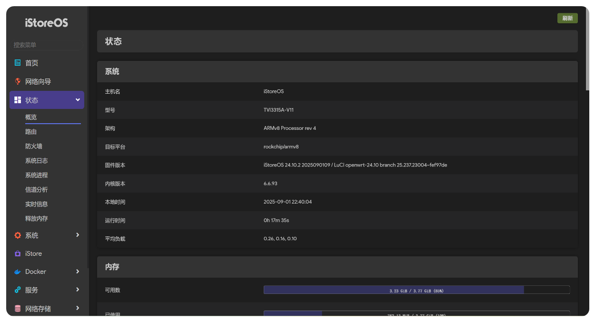

  
  <h1>✨ 基于官方源码编译的iStoreOS固件 ✨</h1>

  
  
  
  

  
  
  
  
  
  
  

---

## 🤔 项目介绍 
**iStoreOS** 目标是提供一个人人会用的路由兼轻 **NAS 系统** ，不管是作为路由还是 NAS，你都有相似的操作体验

> [!TIP]
> 📢本项目提供了一个 **将第三方 rockchip 设备适配至 iStoreOS 官方源码** 的参考实现，支持通过源码编译生成 **`sysupgrade`** 格式固件。该格式可手动在线刷写升级， **一次适配，持续更新** ，告别重复刷机
> 
> 当前默认编译 **iStoreOS 25.12（内核 6.12）**，如需旧版可将 `.github/workflows/build-istoreos-6.x.yml` 中的 `REPO_BRANCH` 改回 `istoreos-24.10`
> 
> 使用此仓库必须设置机密token，Actions云编译固件时需要用到，通常在仓库设置里面。机密键名为 **`GH_TOKEN`**（严禁在仓库可视代码中填写，否则后果自负）

---

## 😅 插件说明 
固件内置插件与官方 iStoreOS 固件保持一致（配置来自官方 [config.buildinfo](https://fw0.koolcenter.com/iStoreOS/easepi-r1/config.buildinfo)），其余插件可从 iStore 商店安装。

已内置增强插件：
- **OpenAppFilter (OAF) 应用过滤**：基于 DPI 深度包检测的上网行为管理插件，支持游戏 / 视频 / 聊天 / 下载等数百款应用的识别与过滤、按时间段管控、用户分组等功能。
  - 源码 feed：`https://github.com/jjm2473/OpenAppFilter.git -b dev7`（jjm2473 针对 iStoreOS / 6.x 内核维护的适配分支）
  - 已默认安装组件：`kmod-oaf`（内核模块）、`appfilter`（用户态守护进程）、`luci-app-oaf`（Web 界面）、`luci-i18n-oaf-zh-cn`（中文语言包）
  - ⚠️ 使用提示：
    - 请将设备作为**主路由**使用，并**关闭防火墙中的软件/硬件流量加速（flow offloading / SFE / Shortcut-FE）**，否则会绕过 netfilter 导致应用识别失效；
    - 若与广告过滤、QoS、多 WAN、负载均衡等同样操作 nf_conn mark 的模块冲突，可能出现过滤无效，请按需关闭冲突功能；
    - 首次使用请在 Web 界面「网络 → 应用过滤」中开启服务、勾选需要过滤的应用并保存生效，特征库可在插件页面在线更新。

## 😊 支持设备 
| 设备         |  状态     |  包名                                                                  | 备注                        |
|-------------|:---------:| ----------------------------------------------------------------------- |:----------------------------:|
| panther-x2  |    ✅    | istoreos-rockchip-armv8-panther_panther-x2-squashfs-sysupgrade.img.gz   | 🟢 已测试                    |
| g68-plus    |    ✅    | istoreos-rockchip-armv8-nsy_g68-plus-squashfs-sysupgrade.img.gz         | 🟡 未测试                    |
| 其他        |    ⏳    |                                                                          |                              |

✅ 支持 - ⏳ 计划中 - ⭕ 不支持

---

## 🤗 项目截图 

---

## 🌟 Star戳一戳，好运加满！😆
> **"点过 `Star` 的朋友，颜值与智慧双双在线！✨"**
> 
> **"您的每一个⭐️，都是开源土壤里的一缕阳光，让灵感发芽，让创造生长~"**

## 🎉 Thanks 
- [istoreos](https://github.com/istoreos/istoreos)
- [linux-6.6.y](https://github.com/unifreq/linux-6.6.y)
- https://github.com/Kwonelee/iStoreOS-Actions

## 🙏 免责声明 
- 📚 本固件仅供学习研究，严禁用于任何商业用途
- 🤝 使用本固件产生的所有后果均由使用者自行承担
- ⚠️ 固件仍可能存在缺陷，开发者不提供任何形式的技术支持
- 📜 请严格遵守国家网络安全法律法规，合法使用

